# OrderIt - MERN e-commerce platform with an AI shopping assistant


**Author:** Sai Pavan ([@Saipavanavsp](https://github.com/Saipavanavsp))

BTech capstone project: a customer storefront, a separate admin dashboard and a secure REST API, with three AI features (the catalogue-grounded **ShopVerse Assistant**, "You may also like" recommendations, and natural-language search).

## Highlights

- **Full MERN stack**, built as three separate apps: customer storefront, admin console and a REST API
- **AI features**: a catalogue-grounded shopping assistant (Claude, with a rule-based fallback), natural-language search ("wireless headphones under 5000" → category + type + price filters) and product recommendations
- **Security**: JWT access and refresh tokens in HTTP-only cookies with rotation, account lockout, rate limiting, Zod validation and HMAC-verified payments
- **Commerce flow**: cart, coupons, GST, checkout with Razorpay (test mode), order tracking, reviews and wishlist
- **Admin**: revenue and order analytics (Recharts), product, inventory, order, user, review, coupon, category and brand management
- **Quality**: 109 Jest + Supertest tests, OpenAPI/Swagger docs, a Postman collection, ESLint + Prettier and Docker Compose
- **Real data**: 240 products, 101 brands and 1,379 reviews from public datasets, cleaned by a validation pipeline

## Outputs

### Customer storefront

| Home page | Product listing |
|---|---|
| 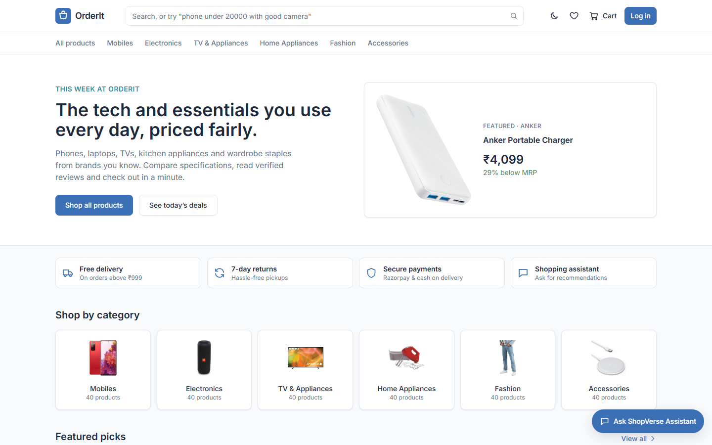 | 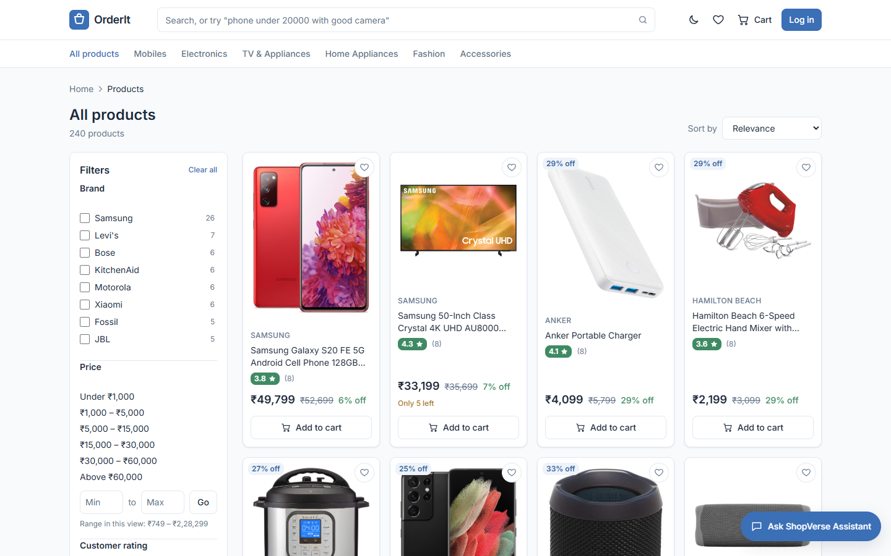 |

| AI natural-language search | Product detail |
|---|---|
| 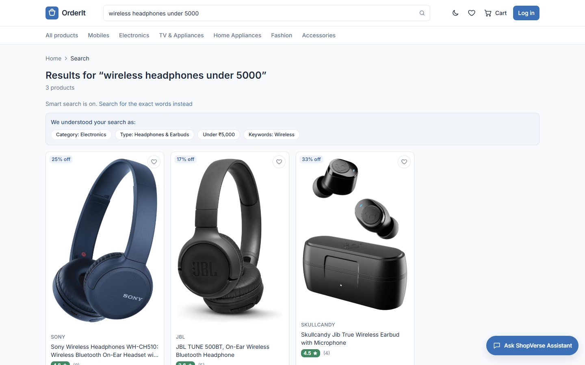 | 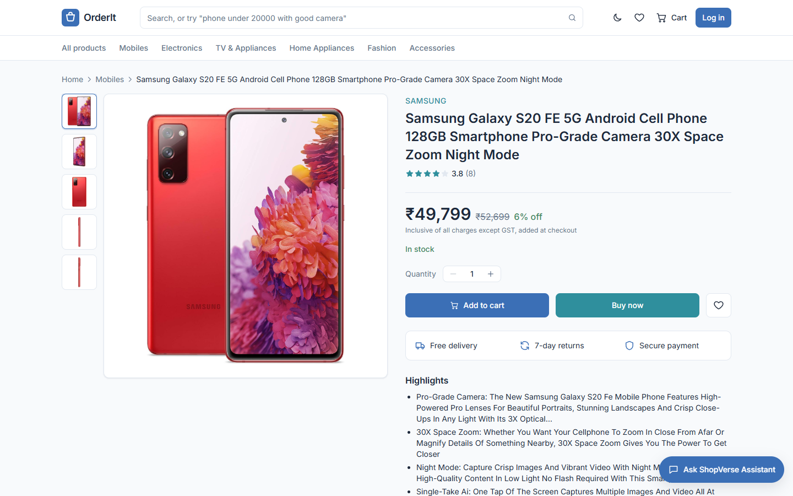 |

| AI shopping assistant | Shopping cart with coupons & GST |
|---|---|
| 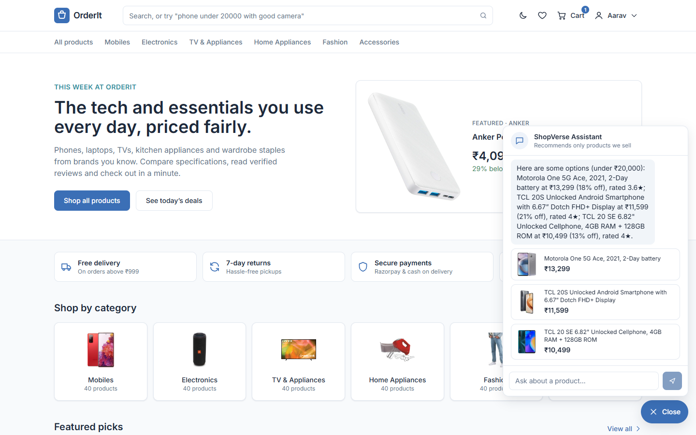 | 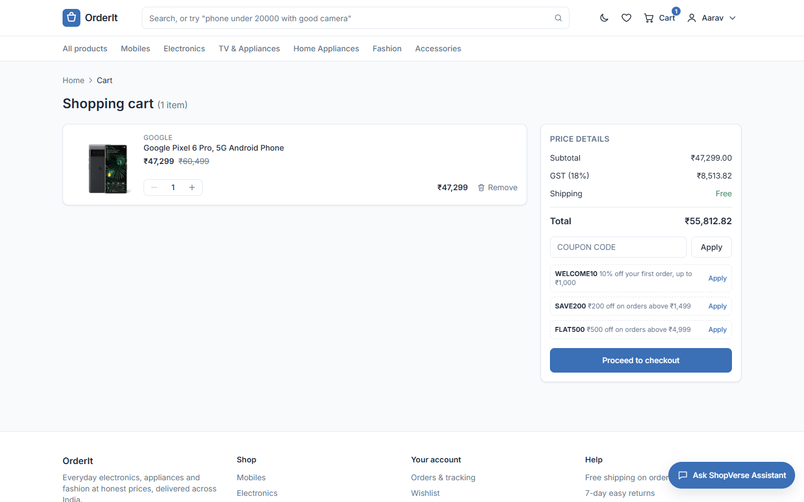 |

| My orders | Login |
|---|---|
| 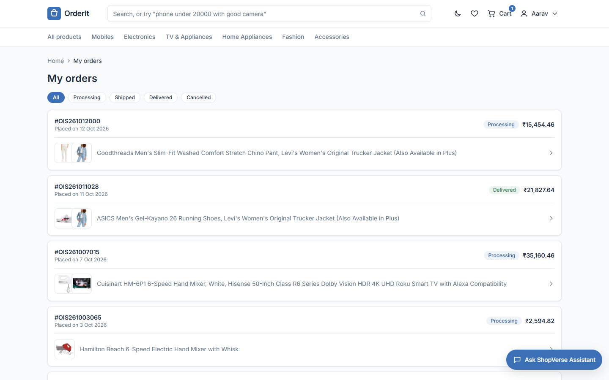 | 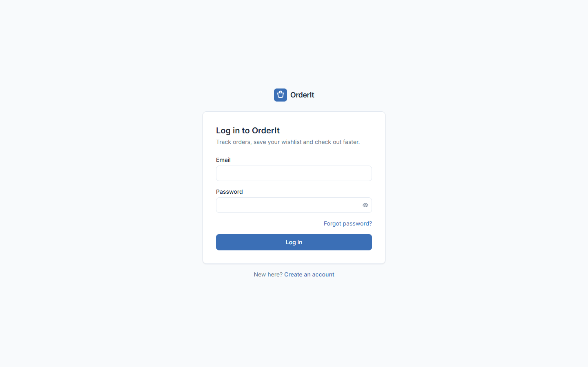 |

<p align="center"><b>Responsive mobile view</b><br>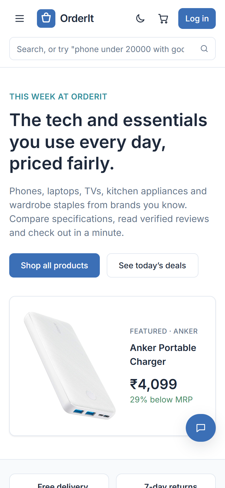</p>

### Admin dashboard

| Dashboard | Sales analytics |
|---|---|
| 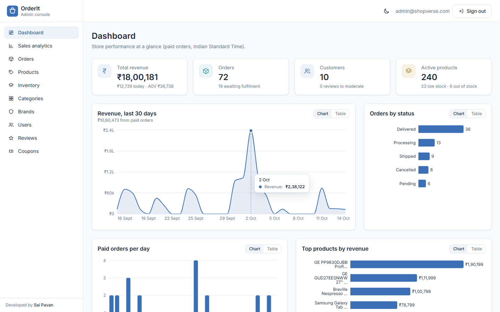 | 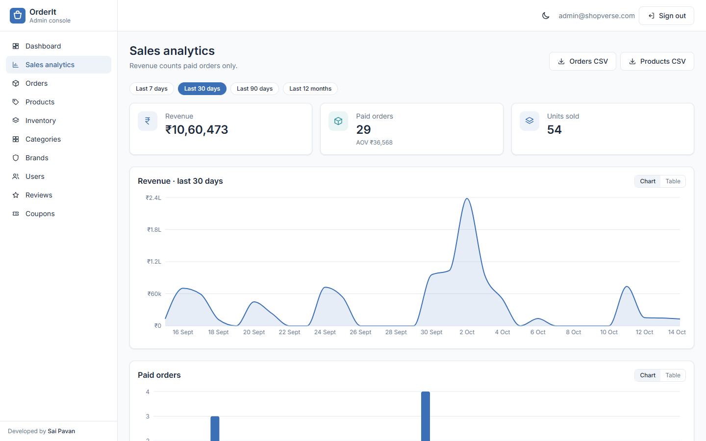 |

| Products | Orders |
|---|---|
| 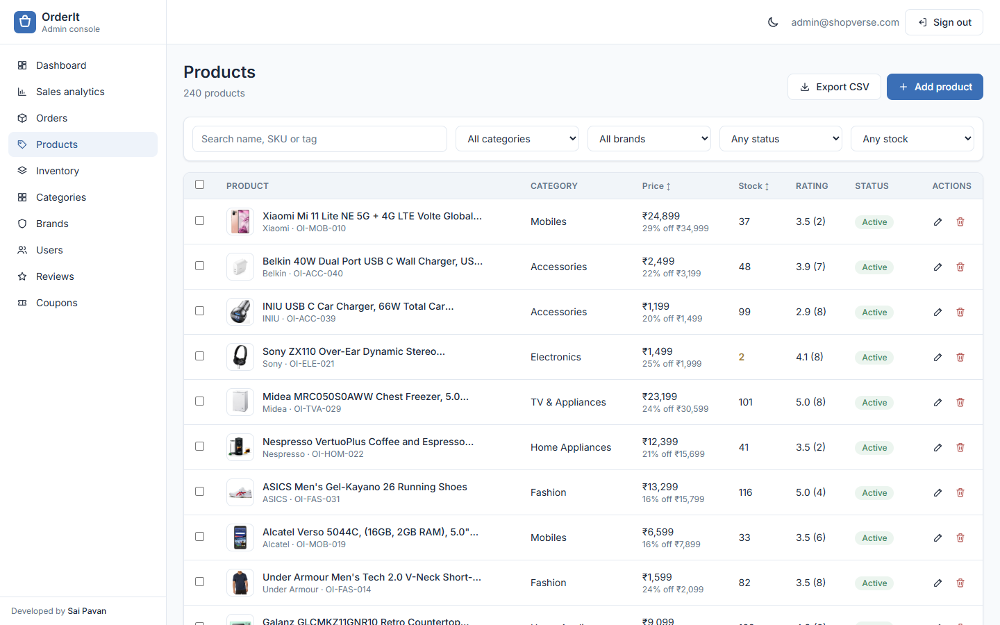 | 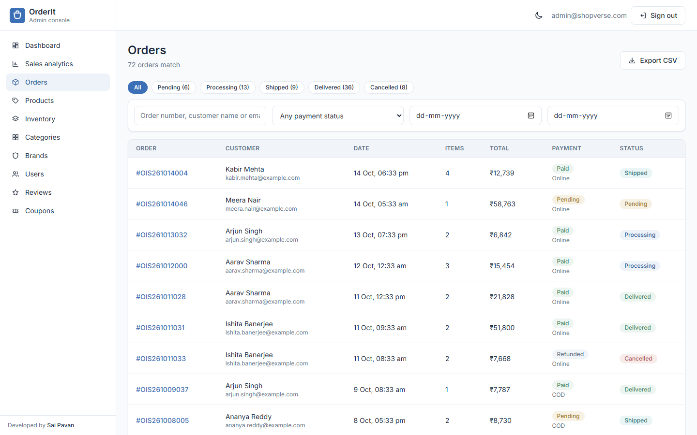 |

| Inventory | Coupons |
|---|---|
| 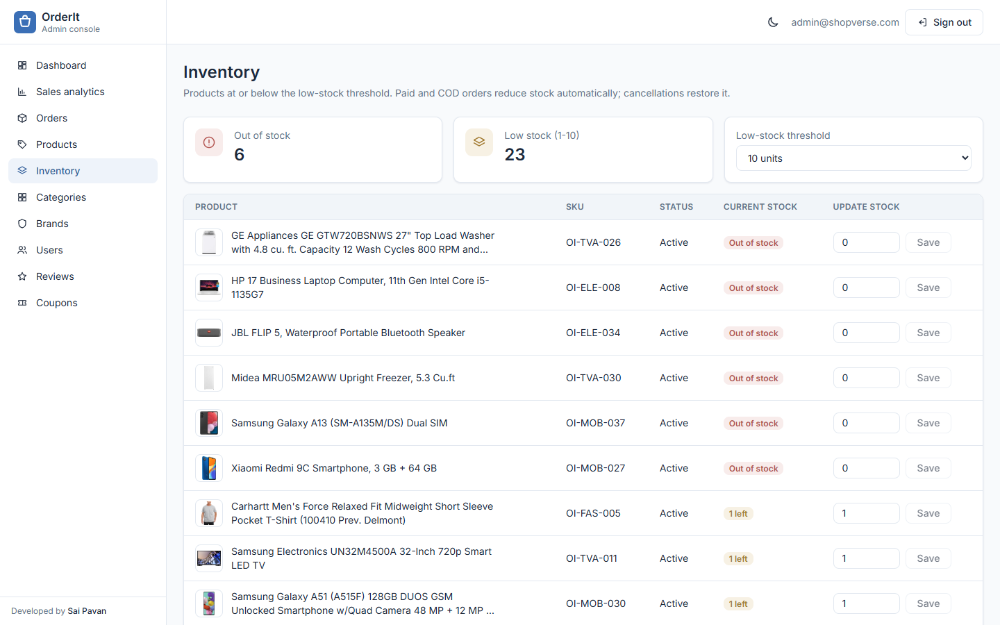 | 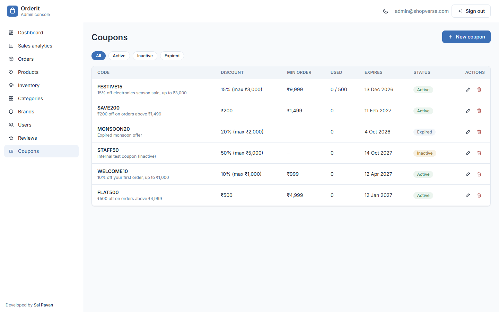 |

### REST API documentation (Swagger)

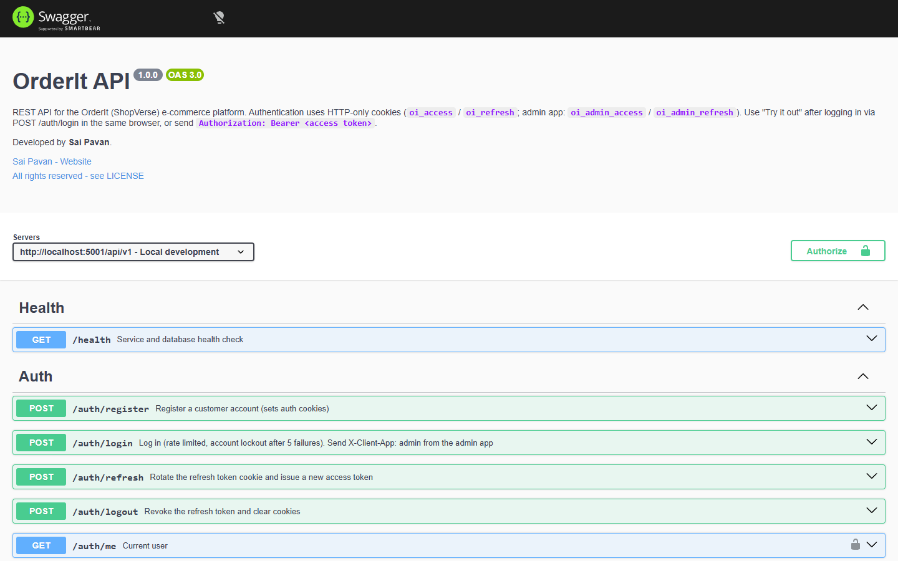

### Test results

`npm test` runs 8 suites (auth, products, cart, orders, admin, AI, data pipeline, API docs) against an in-memory MongoDB:

```text
Test Suites: 8 passed, 8 total
Tests:       109 passed, 109 total
Snapshots:   0 total
Time:        6.725 s
Ran all test suites.
```

| App | URL | Stack |
|---|---|---|
| Customer storefront | http://localhost:5173 | React 19, Vite, Redux Toolkit, Tailwind CSS, Framer Motion |
| Admin dashboard | http://localhost:5174 | React 19, Vite, Redux Toolkit, Tailwind CSS, Recharts |
| REST API | http://localhost:5001/api/v1 | Node 20+, Express, MongoDB/Mongoose, Zod, JWT cookies |
| API docs (Swagger) | http://localhost:5001/api-docs | OpenAPI 3, generated from the route registry |
| Health check | http://localhost:5001/api/v1/health | |

## Quick start (Windows 10/11, PowerShell)

Prerequisites: **Node.js 20+** and **Git**. MongoDB is optional, because the project can run a local database for you.

```powershell
git clone https://github.com/Saipavanavsp/orderit-mern-ecommerce.git
cd orderit-mern-ecommerce

# 1) Database - choose ONE:
#    a) MongoDB service installed:  net start MongoDB        (Administrator PowerShell)
#    b) Nothing installed:          npm run db:local          (run in a separate window and keep it open;
#                                                              first run downloads mongod ~780 MB)
#    c) Atlas: put MONGO_URI=mongodb+srv://... in server/.env after step 2

# 2) Install everything, create .env files, seed the database
npm run setup

# 3) Start API + storefront + admin together
npm run dev
```

`npm run setup` installs the root, `server`, `client` and `admin` packages, copies every `.env.example` to `.env`, checks MongoDB on `127.0.0.1:27017` (printing instructions if it is not running) and seeds the catalogue. `npm run dev` first checks that ports 5001, 5173 and 5174 are free and tells you how to free a busy one:

```powershell
netstat -ano | findstr :5001
taskkill /PID <pid> /F
```

## Demo accounts

| Role | Email | Password |
|---|---|---|
| Admin (admin app only) | `admin@shopverse.com` | `ShopVerse@Admin2026` |
| Customer | `aarav.sharma@example.com` | `Customer@123` |
| Customer (9 more) | `diya.patel@example.com`, `rohan.iyer@example.com`, `ananya.reddy@example.com`, `kabir.mehta@example.com`, `ishita.banerjee@example.com`, `vihaan.gupta@example.com`, `meera.nair@example.com`, `arjun.singh@example.com`, `saanvi.kulkarni@example.com` | `Customer@123` |

Coupons: `WELCOME10` (10% off up to ₹1,000, min ₹999), `FLAT500` (₹500 off above ₹4,999), `FESTIVE15`, `SAVE200`; `MONSOON20` is expired and `STAFF50` is inactive (for testing).

Payments run in **test mode**. Without Razorpay keys a clearly labelled test-payment dialog appears; the server still verifies an HMAC-signed payment before confirming the order. Add Razorpay **test** keys in `server/.env` to use the real Razorpay Checkout.

## Scripts (run from the repository root)

| Command | What it does |
|---|---|
| `npm run setup` | Install all packages, create `.env` files, seed the DB |
| `npm run dev` | Port check, then API (5001) + storefront (5173) + admin (5174) with live reload |
| `npm run seed` | Clear and re-seed categories, brands, users, products, reviews, coupons, demo orders |
| `npm run seed:destroy` | Clear all seeded collections (refuses in production without `--force`) |
| `npm test` | Jest + Supertest suites (in-memory MongoDB, no setup needed) |
| `npm run test:all` | Tests + production builds of both front-ends |
| `npm run build` | Production builds of `client/` and `admin/` |
| `npm run lint` / `lint:fix` | ESLint (flat config) for the whole repository |
| `npm run smoke` | End-to-end check against the running app (register → pay → admin delivers → AI) |
| `npm run db:local` | Run a local MongoDB on 127.0.0.1:27017 (data in `.mongo-data/`) |
| `npm run db:check` | Check MongoDB connectivity |
| `npm run dataset:build` | Re-build the catalogue from Hugging Face (stream → clean → validate images) |
| `npm run images:validate` | Re-validate every product image URL and rewrite `docs/IMAGE_REPORT.md` |
| `npm run dataset:kaggle` | Optional Flipkart (Kaggle) source (needs your Kaggle token) |
| `npm run docs:generate` | Regenerate `docs/API.md` and the Postman collection |

## Optional integrations (`server/.env`)

| Variable | Without it | With it |
|---|---|---|
| `ANTHROPIC_API_KEY` | Rule-based assistant | Claude (`claude-opus-5-5`) answers from catalogue context; the key is never sent to the browser |
| `RAZORPAY_KEY_ID` / `RAZORPAY_KEY_SECRET` | Signed payment simulator | Razorpay test-mode checkout |
| `CLOUDINARY_*` | Uploads saved to `server/uploads/` | Uploads go to Cloudinary |
| `SMTP_*` | E-mails printed in the API console | Real e-mails (order confirmation, status updates, password reset) |
| `MONGO_URI` | `mongodb://127.0.0.1:27017/shopverse` | Any MongoDB / Atlas URI |

## Project structure

```
client/   customer storefront (src: components, pages, layouts, services, hooks, context, store, utils, assets)
admin/    admin dashboard     (src: components, pages, services, charts, utils, context, hooks, store)
server/   REST API            (config, controllers, services, models, routes, middleware, utils, validators,
                               seed/ (pipeline + curated data), docs/ (OpenAPI), tests/, app.js, server.js)
scripts/  check-ports.js, check-mongo.js, local-mongo.js, setup.js, smoke-test.js
docs/     API, DATABASE, DEPLOYMENT, TESTING, DATASETS, IMAGE_REPORT, postman/, capstone/
```

## Documentation

- [docs/API.md](docs/API.md) - every endpoint, conventions, errors, rate limits
- [docs/DATABASE.md](docs/DATABASE.md) - schemas, indexes, ER diagram, consistency rules
- [docs/DEPLOYMENT.md](docs/DEPLOYMENT.md) - Atlas + Render/Railway + Vercel/Netlify, Docker, pre-deploy checklist
- [docs/TESTING.md](docs/TESTING.md) - test suites, test cases, how to run
- [docs/DATASETS.md](docs/DATASETS.md) - data sources, licences, cleaning pipeline
- [docs/IMAGE_REPORT.md](docs/IMAGE_REPORT.md) - image validation results
- [docs/capstone/](docs/capstone) - project report (synopsis, problem, objectives, scope, SRS, diagrams, test cases, future work, conclusion), PPT outline, 25 viva questions

## Troubleshooting (Windows)

| Problem | Fix |
|---|---|
| `Port 5001 is already in use` | `netstat -ano \| findstr :5001` then `taskkill /PID <pid> /F` |
| `MongoDB connection failed` | `net start MongoDB` (Administrator), or `npm run db:local`, or set an Atlas `MONGO_URI` |
| `npm run setup` blocked by execution policy | Run `Set-ExecutionPolicy -Scope CurrentUser RemoteSigned` once |
| Blank product images | Dataset images load from the Amazon CDN, so you need an internet connection |
| Project inside OneDrive is slow / high CPU | OneDrive syncs thousands of `node_modules` files. The API watcher already ignores them, but moving the folder outside OneDrive (e.g. `C:\dev\orderit`) makes installs and builds much faster |
| Logged out after 15 minutes of inactivity in another tab | Expected only if the refresh token expired (7 days); otherwise the app refreshes silently |

## Author

**Sai Pavan**: [github.com/Saipavanavsp](https://github.com/Saipavanavsp)

This project was built as a BTech capstone. The screenshots in [docs/screenshots/](docs/screenshots) were captured from a local run with the seeded demo data.

## License

(c) 2026 **Sai Pavan**. All rights reserved. This repository is public for viewing only. Copying, re-uploading or presenting this project as your own work is not permitted. See [LICENSE](LICENSE).
