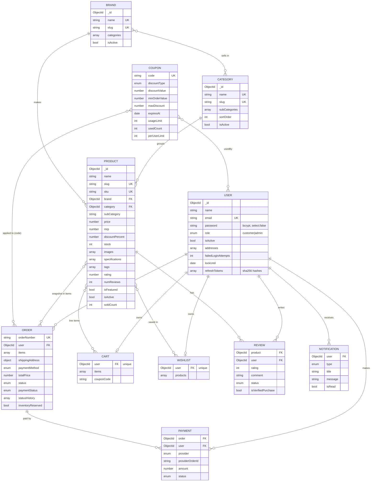

# Database Design

**Author:** Sai Pavan ([github.com/Saipavanavsp](https://github.com/Saipavanavsp))

MongoDB (`shopverse` database) accessed through Mongoose 9. Eleven collections. All documents have `createdAt` / `updatedAt` timestamps.

## Entity-relationship diagram

## Collections

### users
| Field | Type | Rules |
|---|---|---|
| name | String | required, 2-60 chars |
| email | String | required, **unique**, lowercase, regex-validated |
| password | String | bcrypt hash (12 rounds), `select: false`, never serialised |
| role | enum | `customer` (default) / `admin`, indexed |
| isActive | Boolean | default true; deactivated users cannot log in |
| phone, avatar | String | optional |
| addresses[] | sub-document | fullName, phone, line1, line2, city, state, postalCode, country, label, isDefault |
| failedLoginAttempts, lockUntil | Number, Date | account lockout (5 failures → 15 min) |
| refreshTokens[] | {hash, expiresAt, userAgent} | SHA-256 hashes of active refresh tokens (max 5 sessions) |
| passwordResetToken / Expires | String / Date | SHA-256 hash of the e-mailed token, 30 min TTL |
| passwordChangedAt, lastLoginAt | Date | invalidates older access tokens |

Virtual: `isLocked`.

### products
| Field | Type | Rules |
|---|---|---|
| name | String | required, ≤ 200 |
| slug | String | **unique**, generated from name |
| sku | String | unique (sparse), upper-case |
| brand, category | ObjectId → brands / categories | required, indexed |
| subCategory | String | indexed |
| description, highlights[] | String | required description |
| price, mrp | Number | price ≥ 1, mrp ≥ price (enforced) |
| discountPercent | Number | **computed** from price and MRP on validate |
| stock | Number | ≥ 0 |
| images[] | {url, alt} | at least one |
| specifications[] | {label, value} | ordered key/value list |
| tags[] | String | indexed |
| rating, numReviews | Number | recomputed from *approved* reviews |
| isFeatured, isActive | Boolean | indexed |
| soldCount | Number | popularity sort |
| source | {dataset, sourceId, imageLicense} | provenance of dataset items |

Indexes: **text index** `product_text_search` on name (weight 10), tags (6), subCategory (4), description (1); compound `{category, price}`, `{isActive, createdAt}`, `{rating}`, `{soldCount}`. Virtuals: `inStock`, `isLowStock`, `reviews` (populate).

### categories / brands
Unique `name` and `slug`; categories hold `subCategories[]`, `sortOrder`, `image`; brands hold `categories[]` refs. Both have a `products` count virtual. Deleting one that is still used by products is refused.

### carts / wishlists
One per user (unique `user`). Cart items: `{product, quantity 1-10, priceAtAdd}` plus `couponCode`; totals are computed on read from live prices (`services/pricing.service.js`). Virtual `itemCount`.

### orders
Snapshot of each line (`name, slug, image, brand, price, quantity`) so later product edits never change past orders. Pricing fields `itemsPrice, discount, couponCode, taxPrice, shippingPrice, totalPrice`. Status enum `pending → processing → shipped → delivered` or `cancelled`, with `statusHistory[]` (status, note, at, by). Payment: `paymentMethod` (`razorpay`/`cod`), `paymentStatus` (`pending/paid/failed/refunded`), `isPaid`, `paidAt`, `paymentResult`. `inventoryReserved` records whether stock was decremented so cancellation can restore it exactly once. Indexes: unique `orderNumber`, `{user, createdAt}`, `status`, `paymentStatus`. Virtuals `itemCount`, `isCancellable`.

### reviews
`{product, user}` **unique compound index** (one review per user per product). `status` (`pending/approved/rejected`), `isVerifiedPurchase`. Static `recalculateProductRating(productId)` aggregates approved reviews.

### coupons
`code` unique upper-case; `discountType` percent/flat; `minOrderValue`, `maxDiscount` (0 = no cap), `startsAt`, `expiresAt`, `usageLimit` (0 = unlimited), `usedCount`, `perUserLimit`, `usedBy[]`, `isActive`. Redemption uses an atomic conditional update so usage limits cannot be exceeded under concurrency. Virtual `isExpired`.

### payments
One per payment attempt: `provider` (`razorpay`, `simulation`, `cod`), `providerOrderId`, `providerPaymentId`, `amount` (INR), `status` (`created/paid/failed/refunded`), `failureReason`.

### notifications
`{user, type, title, message, link, isRead, readAt}` with index `{user, createdAt}`. Created on registration, order placement, payment, status changes, review moderation and password changes.

## Consistency rules

- **Stock** is decremented with `updateOne({_id, stock: {$gte: qty}}, {$inc: {stock: -qty}})` per line, with compensation (rollback) if any line fails, so concurrent checkouts can never oversell (covered by a test). This works on a standalone MongoDB without replica-set transactions.
- Online orders decrement stock when the payment signature is verified; COD orders when placed. Cancellation restores stock if `inventoryReserved` is true.
- Product `rating`/`numReviews` only count approved reviews.
