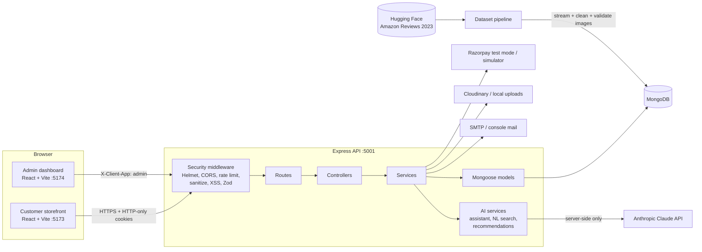
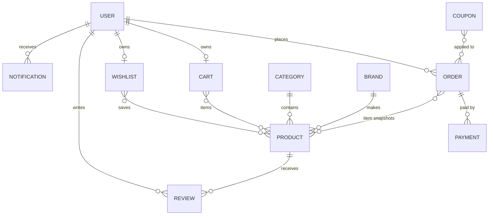
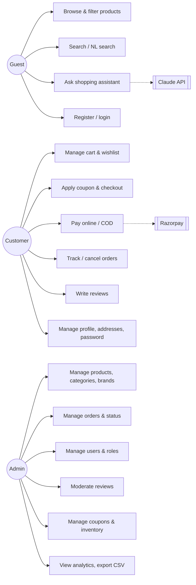
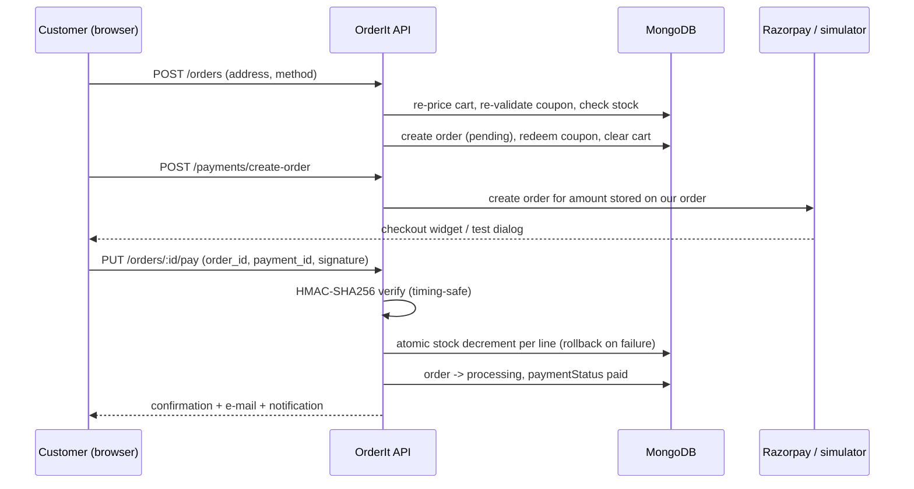

# OrderIt - An AI-Assisted MERN E-Commerce Platform

**BTech Final-Year Capstone Project Report**

---

## 1. Project synopsis

OrderIt is a full-stack e-commerce platform for the Indian market built on the MERN stack (MongoDB, Express, React, Node.js). It has three applications: a **customer storefront** (browse, search, cart, checkout, orders), a separate **admin dashboard** (catalogue, orders, users, reviews, coupons, inventory, analytics) and a **REST API** that both share. Three AI features are built in: a catalogue-grounded shopping assistant ("ShopVerse Assistant") backed by the Anthropic Claude API with a rule-based fallback, "You may also like" recommendations combining content similarity with co-purchase data, and a natural-language search that turns queries such as *"phone under 20000 with good camera"* into structured filters.

The catalogue is built by a reproducible data pipeline. It streams the public **Amazon Reviews 2023** dataset (Hugging Face), then cleans and normalises the records. It maps them to six store categories, converts prices to INR, and validates every product image over HTTP before seeding about 240 products with real specifications and reviews.

## 2. Problem statement

Small and mid-sized Indian retailers that want to sell online face three problems:

1. **Building a secure, complete store is expensive.** Off-the-shelf themes rarely cover the whole lifecycle (inventory, coupons, payments, order tracking, moderation, analytics) with correct security: hashed passwords, token rotation, rate limiting, input sanitisation and payment-signature checks.
2. **Product discovery is weak.** Keyword search fails on how people actually ask ("a good camera phone under 20k"), and static "related products" lists ignore what customers really buy together.
3. **Catalogue data quality is poor.** Demo stores are filled with fake products whose images do not match their names, which undermines trust and makes testing unrealistic.

OrderIt addresses these with an end-to-end reference implementation, AI-assisted discovery that is grounded in the store's own catalogue, and an auditable data pipeline with image-integrity checks.

## 3. Objectives

1. Design and implement a secure, layered (route → controller → service → model) REST API with 93 documented endpoints.
2. Provide a responsive customer storefront covering home, category pages, filtering, search, product detail, cart, wishlist, coupons, checkout, payments, order tracking and account management.
3. Provide a separate admin dashboard for catalogue, order, user, review, coupon and inventory management with sales analytics and CSV export.
4. Integrate Razorpay (test mode) with server-side HMAC signature verification, plus a signed simulation mode for development without keys.
5. Keep inventory consistent under concurrency: stock decrements on payment (or on COD placement) and is restored on cancellation, with no overselling.
6. Implement three AI features: an LLM assistant restricted to catalogue products, content-plus-co-purchase recommendations, and natural-language search.
7. Build a reproducible dataset pipeline from open datasets with cleaning, normalisation, and image validation documented in a report.
8. Achieve automated test coverage of authentication, products, cart, orders, admin and AI flows, and keep the documentation in sync with the code.

## 4. Scope

**In scope:** customer and admin web applications; JWT cookie authentication with refresh rotation; RBAC (customer, admin); product catalogue with 6 categories; cart, wishlist, coupons; COD and online payments (Razorpay test mode or simulation); order lifecycle with history and notifications; reviews with moderation; inventory with low-stock alerts; analytics; CSV export; image upload (Cloudinary or local); e-mail (SMTP or console); AI assistant, recommendations and NL search; Docker and cloud deployment guides.

**Out of scope (see Future enhancements):** multi-vendor marketplace, live courier integration, GST invoices, multi-currency or multi-language support, native mobile apps, real refunds through the gateway API.

## 5. Software Requirements Specification (SRS)

### 5.1 Users and roles
| Role | Description |
|---|---|
| Guest | Browses, searches and views products; must log in to buy |
| Customer | Manages cart, wishlist, orders, addresses, reviews and profile |
| Admin | Uses the admin dashboard only; manages the store |

### 5.2 Functional requirements
| ID | Requirement |
|---|---|
| FR-1 | Users can register, log in, log out, refresh sessions, reset a forgotten password via an e-mailed link and change their password. |
| FR-2 | After 5 consecutive failed logins an account is locked for 15 minutes. |
| FR-3 | Products can be listed with full-text search and filters (category, brand, price range, rating, stock, discount), sorted (relevance, popularity, price, rating, newest, discount) and paginated; facets list brands and price range. |
| FR-4 | Search shows suggestions (products, categories, brands) while typing. |
| FR-5 | Product detail shows a gallery, price, MRP, discount, stock status, specifications, description, rating distribution, reviews and related products. |
| FR-6 | The cart supports add, update quantity (limited by stock, max 10), remove and coupons; totals (subtotal, discount, 18% GST, shipping, total) are computed on the server. |
| FR-7 | Checkout accepts a saved or new address and COD or online payment; the server recomputes totals and re-validates the coupon. |
| FR-8 | Online payments are confirmed only after HMAC-SHA256 signature verification. |
| FR-9 | Stock decrements atomically when an online order is paid or a COD order is placed, and is restored on cancellation. |
| FR-10 | Customers can track order status (pending → processing → shipped → delivered) and cancel orders until they ship. |
| FR-11 | Customers can review a product once; reviews appear after admin approval and update the product rating. |
| FR-12 | Admins manage products (CRUD, bulk status, stock), categories, brands, orders (status transitions), users (activate, role), reviews (approve, reject, delete) and coupons. |
| FR-13 | Admins see KPIs, sales charts, top products, category revenue, low stock, and can export orders and products to CSV. |
| FR-14 | The AI assistant answers product and policy questions using only catalogue products, and falls back to rules without an API key. |
| FR-15 | Recommendations rank similar products by category, sub-category, brand, tags, price band and co-purchase frequency. |
| FR-16 | Natural-language search extracts category, brand, price range, rating, sort intent and feature keywords. |
| FR-17 | Users receive notifications and e-mails for account, order, payment and moderation events. |

### 5.3 Non-functional requirements
| ID | Category | Requirement |
|---|---|---|
| NFR-1 | Security | bcrypt (12 rounds), HTTP-only cookies, refresh rotation with reuse detection, Helmet, CORS allow-list, Mongo sanitize, XSS filtering, Zod validation, rate limits, no stack traces in production |
| NFR-2 | Performance | Indexed queries (text, compound); paginated lists; code-split front-ends; listing API typically < 50 ms locally |
| NFR-3 | Reliability | Centralised error handling; e-mail and notification failures never break checkout; idempotent seeding |
| NFR-4 | Usability | Responsive (mobile, tablet, desktop), skeleton loaders, empty and error states, toasts, confirmations, inline validation, keyboard-accessible controls |
| NFR-5 | Maintainability | Layered architecture, ESLint + Prettier (0 errors), generated API documentation, automated tests |
| NFR-6 | Portability | Windows-first scripts (cross-env, rimraf), Docker images, documented cloud deployment |

### 5.4 Hardware and software
Node.js 20+, MongoDB 7+ (local, `npm run db:local`, or Atlas), any modern browser; development on Windows 10/11 with VS Code.

## 6. System design

### 6.1 Architecture

### 6.2 Entity-relationship diagram

Field-level detail: [DATABASE.md](../DATABASE.md).

### 6.3 Use-case diagram

### 6.4 Checkout and payment sequence

### 6.5 AI design
- **Assistant:** for each question the server retrieves up to 8 candidate products with the NL parser and text search, then sends them to Claude (`claude-opus-5-5`, low effort, server-side refusal fallback) inside a `<catalog>` block. The system prompt forbids inventing products. Claude cites products as `[[slug]]`, and the server keeps only slugs it supplied, so a hallucinated product can never reach the UI. Without an API key, or on any API error or refusal, a rule-based engine answers policy questions and lists matching products.
- **Recommendations:** score = 3·same sub-category + 2·same category + 1.5·same brand + 3·Jaccard(tags) + 2·price ratio + min(4, 2·log₂(1+co-purchases)) + 0.2·rating; the top 8 are returned with human-readable reasons. Personalised picks merge the recommendations for recent purchases and wishlist items.
- **NL search:** regex grammar for price ("under/below/between … and …", "20k", "1 lakh"), rating ("4 star", "top rated"), sort intent ("cheapest", "latest"), discount ("deals"), category keywords and catalogue brand names. The remaining words become keywords for MongoDB `$text` search. If keywords match nothing, the filters are kept and the keywords relaxed.

## 7. Implementation summary

| Layer | Technology |
|---|---|
| Front-end | React 19, Vite 8, React Router 7, Redux Toolkit, Axios, Tailwind CSS 3, Framer Motion, Recharts (admin) |
| Back-end | Node.js 20+, Express 4, Mongoose 9, Zod 4, JWT, bcrypt, Multer, Cloudinary SDK, Nodemailer, Razorpay SDK, Helmet, express-rate-limit, express-mongo-sanitize, xss, swagger-ui-express, Anthropic SDK |
| Quality | Jest + Supertest + mongodb-memory-server, ESLint 10 flat config, Prettier |
| Data | Hugging Face Amazon Reviews 2023 (streamed), optional Kaggle Flipkart products |

Key engineering decisions:
- **Separate admin cookies** (`X-Client-App: admin`), because both front-ends share the `localhost` cookie jar.
- **Server-side pricing only**: the client never sends prices or totals.
- **Snapshot order items**, so later catalogue edits do not rewrite order history.
- **Transaction-free atomic inventory** with compensation, which works on a standalone MongoDB.
- **Docs generated from the route registry**, with a test that fails on undocumented routes.

## 8. Testing

See [TESTING.md](../TESTING.md) for the full test-case table and how to run the tests. In summary: 8 Jest/Supertest suites run against an in-memory MongoDB, covering authentication (lockout, refresh rotation and reuse detection, RBAC, password reset), products (filters, sort, pagination, text and partial search, facets, admin CRUD), cart, coupons, wishlist and reviews, orders (signature forgery rejection, inventory, cancellation refunds, a concurrency no-oversell test), admin (status transitions, analytics numbers, CSV, uploads with spoofed-file rejection), AI (parser, grounding, fallbacks, recommendations), the pipeline, and documentation coverage. An end-to-end smoke script (`npm run smoke`) exercises the running system.

### Representative test cases
| ID | Scenario | Expected | Result |
|---|---|---|---|
| TC-01 | Register with weak password and bad email | 400 with field errors for name, email, password | Pass |
| TC-02 | 5 wrong passwords then the correct one | 423 locked, including for the correct password | Pass |
| TC-03 | Replay a rotated refresh token | 401 and all sessions revoked | Pass |
| TC-04 | Customer logs into the admin app | 403 "Admin access only" | Pass |
| TC-05 | NoSQL injection `{ "$gt": "" }` in login | 400, no authentication | Pass |
| TC-06 | `<script>` in profile name | Stored without the script | Pass |
| TC-07 | Filter mobiles + brand + price range | Only matching active products | Pass |
| TC-08 | Search "galax" (partial word) | Regex fallback finds Galaxy phones | Pass |
| TC-09 | Add more than stock to cart | 400 "Only N unit(s) available" | Pass |
| TC-10 | Coupon below minimum, expired, exhausted | Specific error message for each | Pass |
| TC-11 | Forged Razorpay signature | 400, order stays unpaid, stock unchanged | Pass |
| TC-12 | Valid signature | Order paid → processing, stock decremented, e-mail queued | Pass |
| TC-13 | Two buyers race for the last 3 units (2 each) | One 201, one 409, final stock 1 | Pass |
| TC-14 | Cancel a paid order | Status cancelled, paymentStatus refunded, stock restored | Pass |
| TC-15 | Admin marks pending → delivered directly | 400 invalid transition | Pass |
| TC-16 | COD order delivered | Marked paid automatically | Pass |
| TC-17 | Upload a text file renamed to .png | 400 "File content is not a valid image" | Pass |
| TC-18 | NL query "phone under 20000 with good camera" | category=mobiles, maxPrice=20000, keyword camera | Pass |
| TC-19 | Claude returns an unknown product slug | Slug dropped; only catalogue products shown | Pass |
| TC-20 | Undocumented Express route | Documentation test fails | Pass |

## 9. Results

- A working three-application system with 93 REST endpoints, all validated and documented (Swagger and Postman).
- A catalogue of real products across 6 categories from an open dataset, with validated images, real specifications and real review text (see [DATASETS.md](../DATASETS.md) and [IMAGE_REPORT.md](../IMAGE_REPORT.md)).
- All automated tests and the end-to-end smoke test pass; lint reports 0 errors; both front-ends build for production.

## 10. Future enhancements

1. Razorpay webhooks and real refunds through the Refunds API; UPI intent flow.
2. Courier integration (Shiprocket or Delhivery) for live tracking and serviceability by PIN code.
3. GST-compliant invoices (PDF) and HSN codes per product.
4. Vector embeddings for semantic search and recommendations; collaborative filtering at scale.
5. Streaming assistant responses, conversation memory and order-aware support with tool use.
6. Multi-vendor marketplace with seller onboarding and payouts.
7. Progressive Web App with offline catalogue and push notifications; React Native app.
8. Redis caching and a job queue (BullMQ) for e-mails and analytics.
9. MongoDB replica set and multi-document transactions; read replicas for analytics.
10. Hindi and regional-language UI with an i18n framework; accessibility audit to WCAG 2.2 AA.
11. A/B testing of ranking and recommendation weights.

## 11. Conclusion

OrderIt shows that a final-year team can deliver a production-shaped e-commerce system: a layered, secure API with consistent inventory and verified payments, two polished React applications, and AI features that improve discovery without hallucinating products. Its data pipeline replaces made-up demo products with real, image-validated catalogue data. The emphasis throughout was on verifiability: generated documentation, automated tests that encode the business rules, and an end-to-end smoke test. That makes the project easy to evaluate, extend and deploy.

## References
1. Hou, Y. et al. *Bridging Language and Items for Retrieval and Recommendation* (Amazon Reviews 2023), 2024. https://amazon-reviews-2023.github.io/
2. Razorpay Docs - Payment signature verification. https://razorpay.com/docs/payments/server-integration/nodejs/
3. OWASP Cheat Sheet Series - Authentication, Session Management, Input Validation. https://cheatsheetseries.owasp.org/
4. MongoDB Manual - Text indexes; atomic operations. https://www.mongodb.com/docs/manual/
5. Anthropic - Claude API documentation. https://docs.anthropic.com/
